<div align="center">

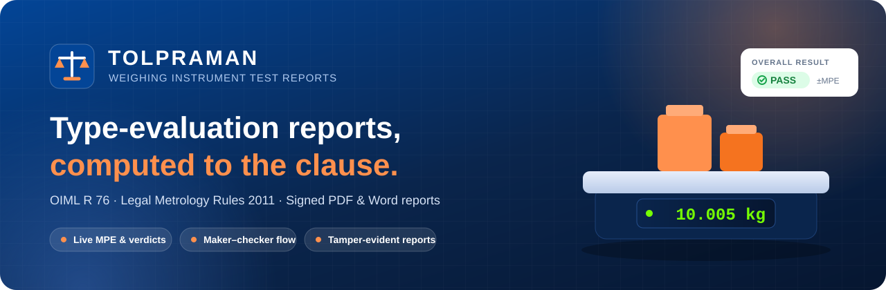

### Compliance & Digital Test-Report Platform for Non-Automatic Weighing Instruments (NAWI)

Type evaluation as per **OIML R 76-1 / R 76-2** and the **Legal Metrology (General) Rules, 2011 – Seventh Schedule, Heading A**


<br>

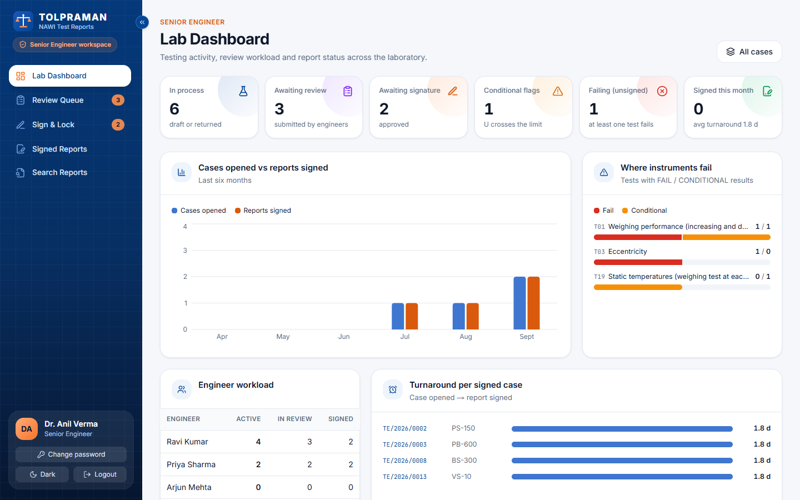

</div>

---

## 📌 About

NAWIs (electronic scales, platform scales, weighbridges) are used in trade, healthcare, agriculture and industry.
Under the Legal Metrology Act, 2009 every model must be approved after **type evaluation** by a designated lab
against OIML R 76. Today those test reports are prepared **manually in spreadsheets and document templates**:
slow, error-prone, and inconsistent from one lab to the next.

**TOLPRAMAN** replaces that workflow. The lab records test observations, the software computes the errors, maximum
permissible errors (MPE) and verdicts for each clause of the standard, and it issues **standardized, digitally
signed, tamper-evident test reports**.

## ✨ Key Features

| Requirement | How TOLPRAMAN delivers it |
|---|---|
| Capture instrument details & specifications | Manufacturer, applicant, model, serial no., class, Max / Min / e / d, multi-interval & multiple-range, tare, power, software |
| Record lab & environmental conditions | Environment log (temperature, humidity, pressure) per test session |
| Enter observations for all R 76 tests | Data-entry forms for **T01–T19**: weighing performance, eccentricity, discrimination, repeatability, return to zero, creep, tilting, tare, warm-up, power variation, EMC, damp heat, span stability, endurance, zero-setting, static temperatures, examination checklist |
| Auto-calculate permissible errors & compliance | Deterministic engine: `E = I + ½e − ΔL − L`, `Ec = E − E0`, MPE by `m = L/e`, uncertainty, PASS / FAIL / CONDITIONAL, **each verdict quoting its clause** |
| Validation checks | Live validation in the browser; the server **re-evaluates** every submission with the same engine |
| Automatic pass/fail per R 76 | Rule packs for the **OIML** and **India (LM GR 2011, Heading A)** profiles |
| Standardized printable reports | **PDF** (Puppeteer) and editable **MS Word (DOCX)**, auto-filled with lab & instrument details, error-vs-load chart with the ±MPE band |
| Digital repository & search | Search reports by number, model, manufacturer, verdict and date; instrument-wise history; CSV export |
| Secure role-based access | JWT + RBAC: Lab In-charge, Test Engineer, Senior Engineer, Admin; **maker-checker** enforced by the API |
| Future updates of OIML | Limits and clauses are **versioned JSON rule packs**, not code. Upload a new version and the impact simulator shows which verdicts would change |
| Attachments & digital signatures | Photos and documents per case; **Ed25519** lab signature, SHA-256 hash and **QR code** on every page |
| Dashboard | Per-role dashboards: workload, overdue, in-process, completed, report status |

**Also included:**
- 🔗 **Hash-chained readings and audit log.** Any change to stored data breaks the chain, and the case can't be signed.
- 📱 **Public QR verification.** Upload a PDF at `/verify/<id>` and the page reports **AUTHENTIC**, **MODIFIED**, **REVOKED** or **SUPERSEDED**.
- 🔁 **Revisions.** A signed report can be reopened. The new report states "Revision n, supersedes TR/…".
- 🧪 **Per-test review.** The Senior Engineer approves each test individually or sends it back for re-test.
- 📥 **CSV / Excel paste import** on every readings table, plus a serial-port **scale simulator**.
- 🚫 **No AI/ML in the legal calculation path.** Results are deterministic and covered by 1,100+ golden tests.

## 📸 Screenshots

| Login | Lab In-charge Dashboard |
|---|---|
| 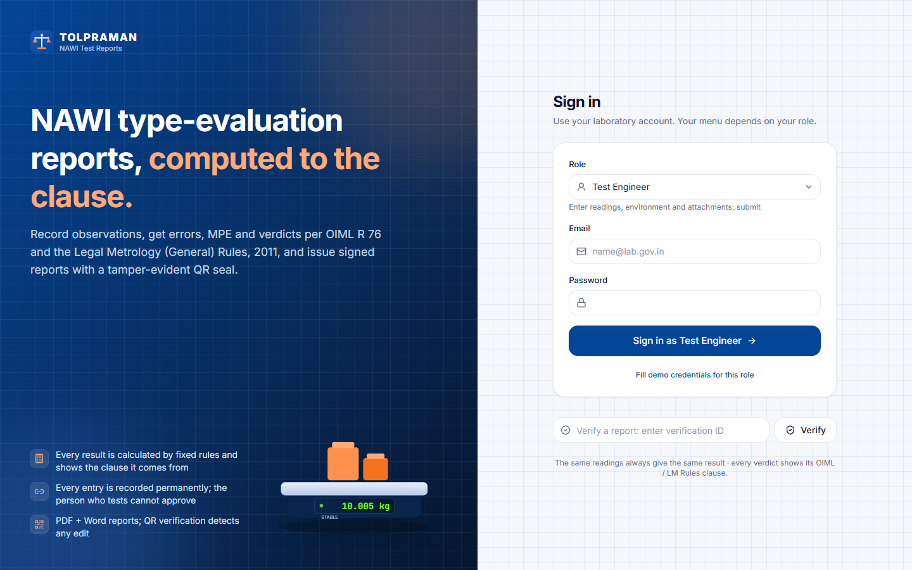 | 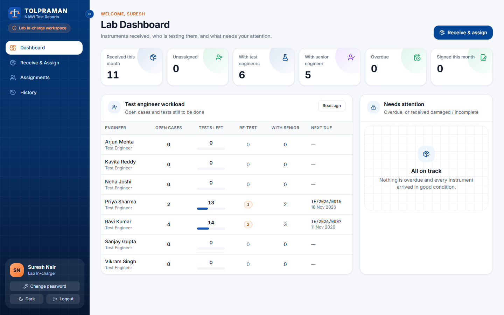 |

| Receive Instrument & Assign | Test Engineer – My Cases |
|---|---|
| 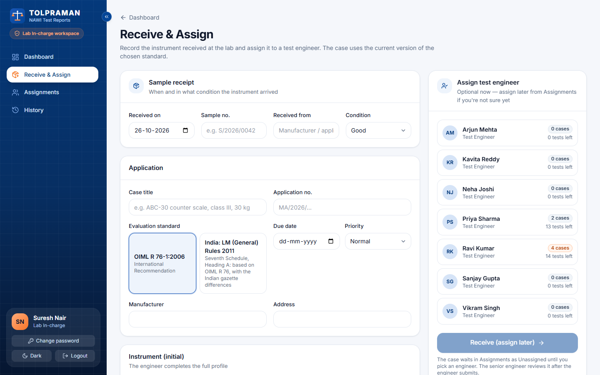 | 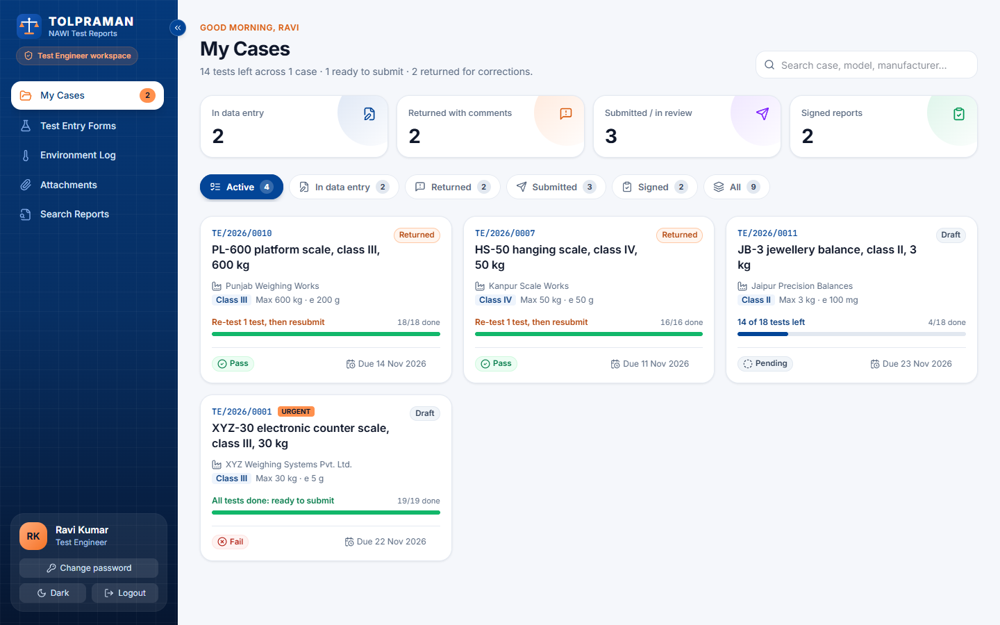 |

| Test Entry with Live Verdicts | Senior Engineer Dashboard |
|---|---|
| 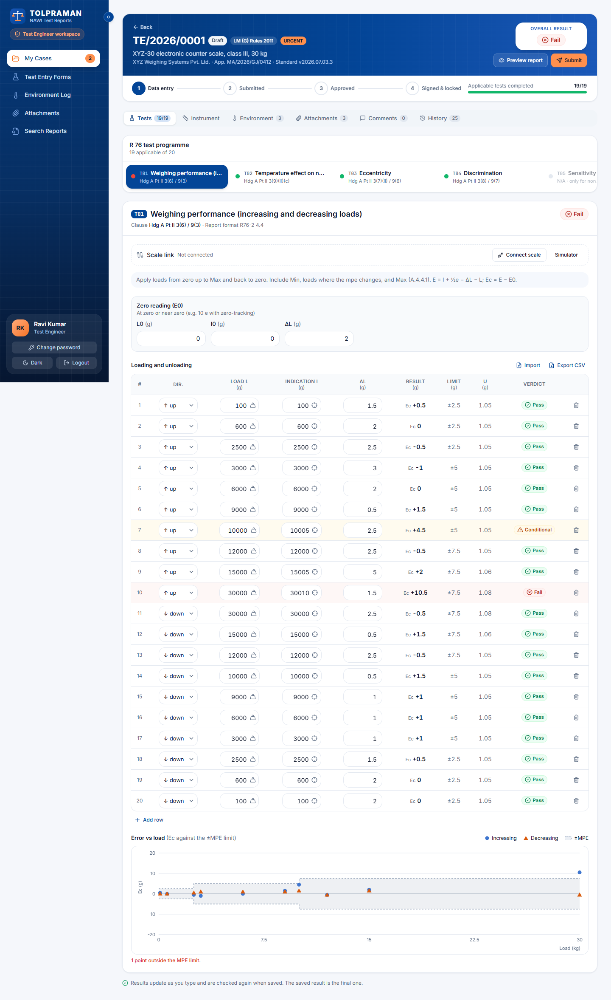 |  |

| Review Queue | Test-by-Test Review |
|---|---|
| 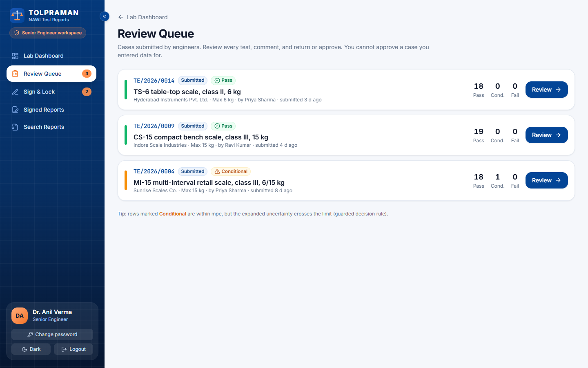 | 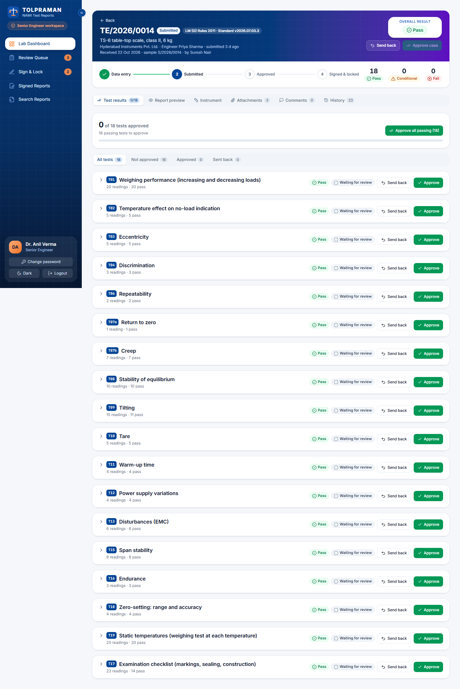 |

| Search Reports | Admin – Users & Roles |
|---|---|
| 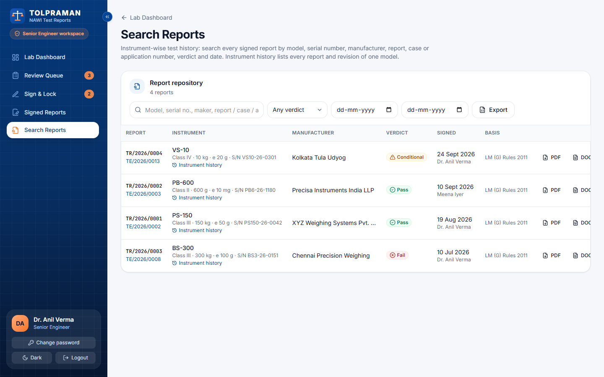 | 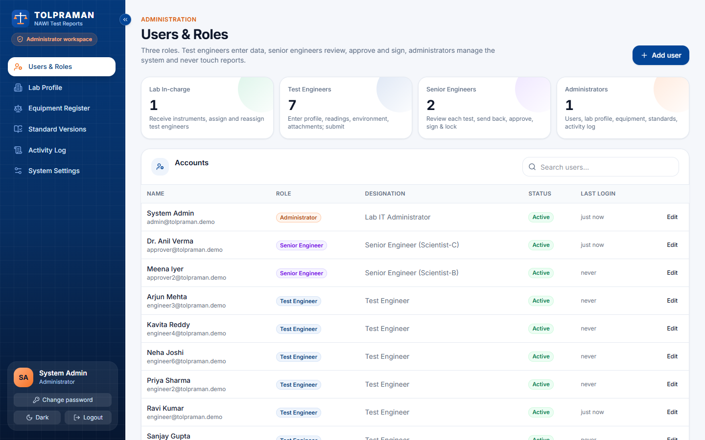 |

| Admin – Standard Versions (Rule Packs) | Public QR Verification |
|---|---|
| 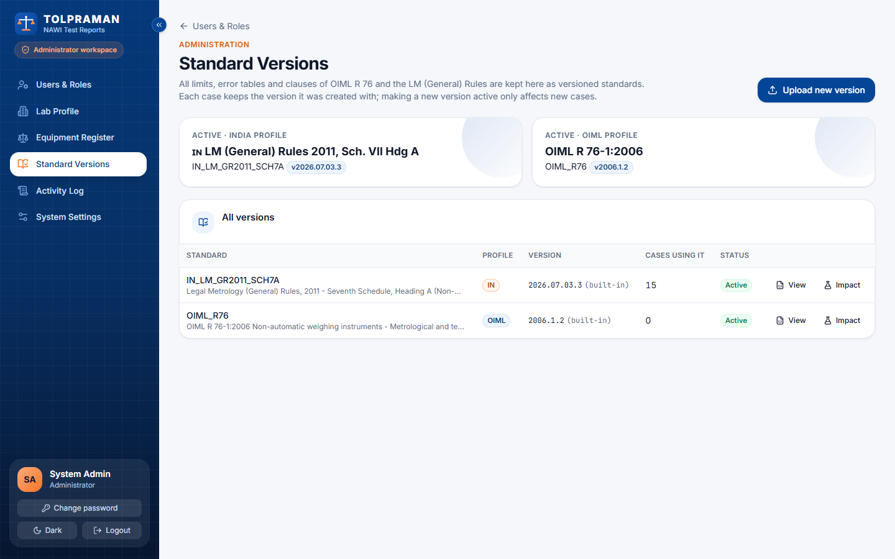 | 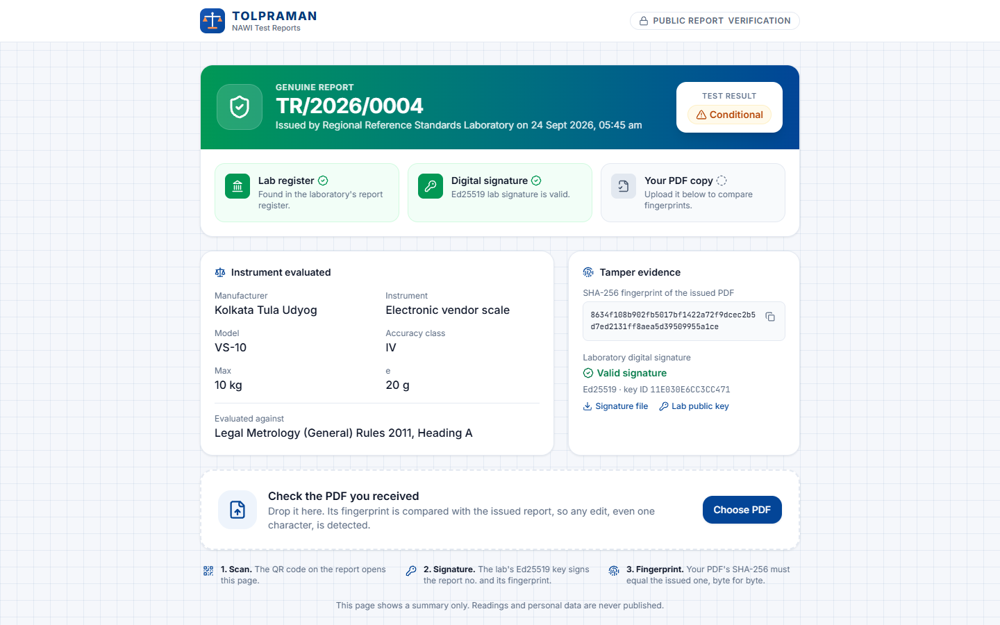 |

> To regenerate the screenshots, start the app with demo data, then run `node scripts/screenshots.mjs`.

## 🏗️ Architecture

```
 Browser (Next.js web app, desktop first, responsive down to 375 px)
   │  forms per test, live verdicts ── shared/engine (same code as the server)
   │  REST / JSON via the Next.js rewrite /api/* → backend
   ▼
 Backend (Node.js + Express)
   ├─ auth: JWT access + refresh tokens, bcrypt, role guard on every route
   ├─ cases, readings (hash chain), per-test review, sign & lock, revisions
   ├─ shared/engine re-evaluates every submission (server result is authoritative)
   ├─ reports: HTML → PDF (Puppeteer), DOCX, QR code, SHA-256, Ed25519 signature
   └─ public /api/verify/:id (QR target, no login)
   ▼
 MongoDB (cases, readings, rule packs, reports, audit log)    File storage (attachments, PDF, DOCX)
```

```
frontend/          Next.js 16 web app (4 roles) — Tailwind 4
backend/           Express + MongoDB API: auth/RBAC, cases, hash-chained readings, reports (PDF/DOCX/QR), verify
shared/engine/     Deterministic calculation engine (TypeScript, runs in browser AND server) + golden tests
shared/rulepacks/  Rule packs as data: OIML R 76 + India (LM GR 2011 Hdg A, amended to G.S.R. 568(E) 03-07-2026)
docs/              ARCHITECTURE.md, CALCULATIONS.md, DEPLOYMENT.md, PROGRESS.md, source standards
scripts/           dev runner, stop script, screenshot capture
```

Frontend and backend never import each other; both use only `shared/`.

📄 Detailed docs: [Architecture](docs/ARCHITECTURE.md) · [Calculation methodology](docs/CALCULATIONS.md) · [Deployment](docs/DEPLOYMENT.md) · [Progress](docs/PROGRESS.md)

## 👥 Roles & Workflow

```
 Lab In-charge ──► Test Engineer ──► Senior Engineer ──► Signed Report (PDF + DOCX + QR)
 receive sample     enter readings     review each test       public verification
 assign engineer    live verdicts      approve / send back    revision & supersede
```

| Lab In-charge | Test Engineer | Senior Engineer | Admin |
|---|---|---|---|
| Dashboard (workload, overdue) | My Cases | Lab Dashboard | Users & Roles |
| Receive & Assign | Test Entry Forms | Review Queue | Lab Profile |
| Assignments (reassign) | Environment Log | Sign & Lock | Equipment Register |
| History (receipt + assignments) | Attachments | Signed Reports | Standard Versions |
| | Search Reports | Search Reports | Activity Log |

1. **Lab In-charge** records the instrument's arrival (date, sample no., condition) and assigns a test engineer.
2. **Test Engineer** enters readings. The rule engine checks every test live, and the submit screen lists each result.
3. **Senior Engineer** reviews **test by test**: approves (FAIL / CONDITIONAL need a confirming note) or sends the test back for re-test. Once every test is approved: **sign & lock**, which produces the PDF and DOCX.
4. Only sent-back tests can be edited. Changing the readings of an approved test, or the class / Max / Min / e, cancels that approval automatically.
5. **Revision:** a signed case can be reopened. The old report shows **Superseded** on its verify page once the new one is signed.

The Lab In-charge never sees readings, results or reports, and the API enforces this.

## 🚀 Getting Started

**Requirements:** Node.js ≥ 20.9. No MongoDB install is needed in development; an embedded MongoDB starts automatically.

```bash
git clone https://github.com/runtimeXerror/Tol-praman-weighing-instrument-test-reports.git
cd Tol-praman-weighing-instrument-test-reports
npm install
npm run seed -- --reset   # demo lab, users, weights, 8 cases, 3 signed reports
npm run dev               # backend :4000 + frontend :3000 (Ctrl+C stops both)
```

Open **http://localhost:3000**.

### Demo accounts

| Role | Email | Password |
|---|---|---|
| Lab In-charge | incharge@tolpraman.demo | Incharge@123 |
| Test Engineer | engineer@tolpraman.demo | Engineer@123 |
| Senior Engineer | approver@tolpraman.demo | Approver@123 |
| Senior Engineer 2 (two-level approval) | approver2@tolpraman.demo | Approver@123 |
| Admin | admin@tolpraman.demo | Admin@123 |

Pick the **Role** on the login page. The "Fill demo credentials for this role" link fills in the login.

### Docker (production)

```bash
docker compose up -d      # frontend, backend, mongo, minio
```

See [DEPLOYMENT.md](docs/DEPLOYMENT.md).

### Troubleshooting

- **Login hangs / "Database not available"**: check free disk space; MongoDB stops when the drive is full.
- **`EADDRINUSE :3000` / `:4000`**: run `npm run stop`, then start again.

## 🎬 Demo Story (3 minutes)

1. **Engineer** → My Cases → `XYZ-30` → T01: the 10 kg row is **CONDITIONAL** (Ec 4.5 g, mpe 5 g, U ≈ 1 g) and 30 kg is **FAIL** (10.5 g > 7.5 g). Use the **Simulator** to capture a reading → the verdict updates → **Submit**.
2. **Senior Engineer** → Review Queue → add a note on a test → **Return**. Engineer fixes it → resubmits.
3. **Senior Engineer** → **Approve** → **Sign & lock** → open the PDF (QR on every page).
4. On the verify page, upload an edited PDF → **MODIFIED**. Revoke the report → **REVOKED**.

## 🧪 Tests

```bash
npm test          # 1,187 tests
npm run typecheck
```

| Suite | Tests | Covers |
|---|---|---|
| Rule packs | 12 | schema validation, loader, India pack overrides |
| Engine | 1,122 | golden cases, every band edge of Table 3/6 for both profiles, MPE envelope, T17–T19, property tests |
| API | 36 | role matrix, receipt & assignment, per-test review, locks, revisions, chain integrity, sign/verify, Ed25519, search |
| Web | 17 | CSV import / export |

## 📚 Standards & Sources

Only values from the rule packs are used, and each verdict carries its clause. Sources are in [`docs/standards/`](docs/standards):
OIML R 76-1 (2006), OIML R 76-2 (2007), Legal Metrology (General) Rules 2011 with amendments up to 2026, and
Legal Metrology (Approval of Models) Rules 2011. Items the gazette text leaves ambiguous are marked `TODO-VERIFY`
in the rule packs.

## 🛠️ Tech Stack

| Layer | Technology |
|---|---|
| Frontend | Next.js 16 (App Router), React, Tailwind CSS 4, Recharts |
| Backend | Node.js, Express, Mongoose, JWT, bcrypt, Zod |
| Database / Storage | MongoDB, MinIO (prod) / local disk (dev) |
| Reports | Puppeteer (PDF), docx (Word), qrcode, SHA-256, Ed25519 |
| Engine | Pure TypeScript, shared by browser and server |
| Testing | Vitest, supertest, mongodb-memory-server |
| Deployment | Docker Compose |

